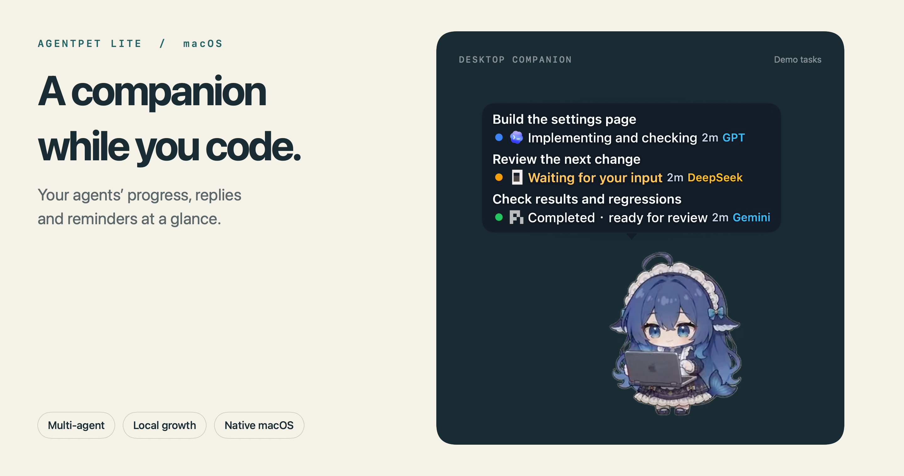
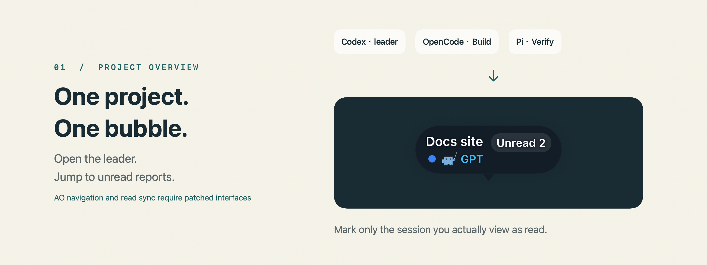
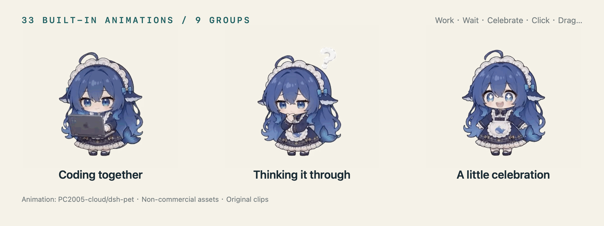
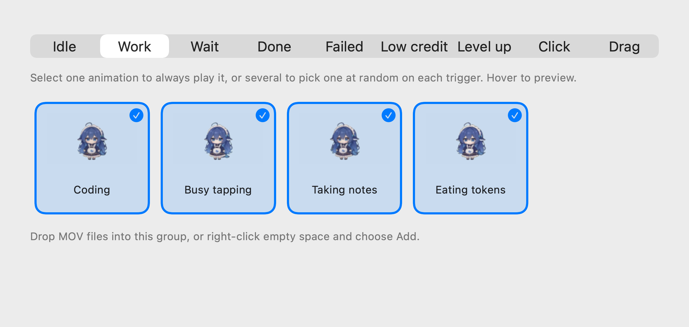
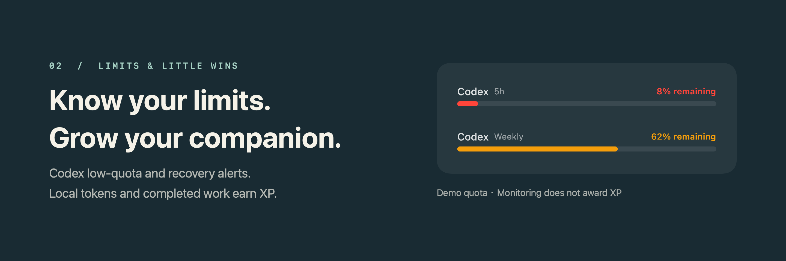
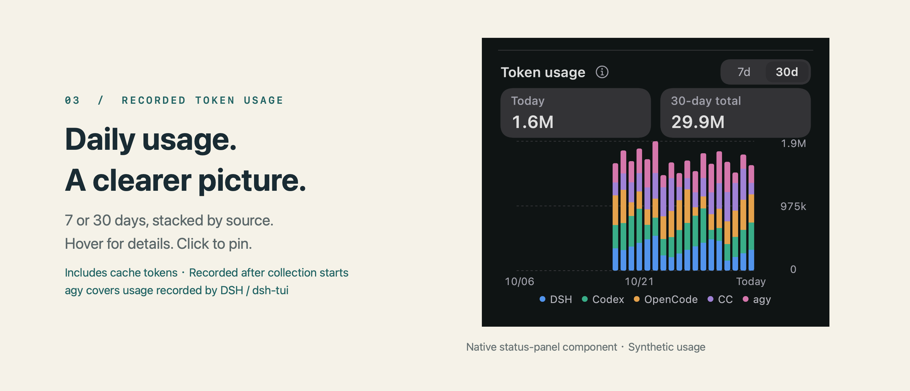

# AgentPet Lite

[简体中文](README.md) · **English**

**Your coding agents' progress, right on your desktop.**

A native macOS companion that brings coding-agent tasks, public replies and reminders to a corner of your screen. Keep coding while it keeps an eye on progress.

**macOS 13+ · Apple Silicon · Swift / SwiftUI · Local pet growth**

[Get started](#get-started) · [Supported agents](#supported-agents) · [Integration guide](docs/agent-integrations.md) · [Custom animations](docs/pet-animation-packs.md)

[](.github/readme/hero-en.png)

A maintained derivative of [AgentPet](https://github.com/ntd4996/agentpet), with continued work on multi-agent integrations, AO project summaries, read synchronization, session filtering and animation management. The bundled whale-girl animations come from [dsh-pet](https://github.com/PC2005-cloud/dsh-pet).

The app interface supports **English / Tiếng Việt / 简体中文 / 繁體中文**, selectable in Settings.

> Task names, model labels and quota values in these images are demo data. Task bubbles and quota bars are rendered with the current native components; animation clips come from the bundled assets. The linked technical guides are currently in Chinese.

Click an image to open its full-resolution version.

## Know when to switch back to your terminal

| What you want to know | What appears on your desktop |
| --- | --- |
| What are my agents working on? | Multiple task bubbles with titles, status, model and elapsed time; filter by source |
| Is it finished or waiting for me? | Distinct working, human-input, completed, failed and stopped states, plus public replies and reminders |
| Which session should I open? | Jump to supported sessions and manage unread results with read receipts |
| Will it get in the way? | Click-through bubbles, edge tucking, opacity and display-duration controls; filter Codex internal helpers and temporary side chats |
| What else is there? | Pet growth, animation selection, project binding, custom short phrases, quota alerts and a Pomodoro timer |

Public replies come from content your agents have already produced. **No extra model calls are made to generate companion chatter.** Double-click the pet to toggle task-bubble click-through; items that need manual handling temporarily restore interaction.

## One project, one bubble

With Agent Orchestrator (AO), a project's leader and workers share one summary bubble. The main entry opens the leader; **Unread N** opens an unread member. Only the session actually viewed is marked as read, leaving the others unread.

[](.github/readme/project-overview-en.png)

This experimental option is off by default. Exact navigation and read synchronization inside AO require a patched AO build exposing the corresponding interfaces; stock AO does not provide these added interfaces. [Integration requirements →](docs/agent-integrations.md)

## Raise a companion as you code

The first launch installs **33 bundled whale-girl animations offline**. They are organized into **9 groups**: idle, working, waiting, success, failure, low quota, level-up, click and drag. Select several clips in a group for a different response each time.

[](.github/readme/animations-en.gif)

Available token usage from local Codex / Claude Code sessions and rewards for successfully completed turns earn experience. Each pet keeps its own level, growth and achievements. **Subscription quotas are for monitoring and reminders; they do not grant experience.**

<details>
<summary><strong>See animation selection: multiple clips, hover previews and drag-in import</strong></summary>

[](.github/readme/animation-settings-en.png)

Open Settings → Pet → Animations. Select one clip to keep that response, or several to choose randomly when triggered. Import compatible transparent MOV files or your own animation packs. [Animation formats and import guide →](docs/pet-animation-packs.md)

</details>

## Keep track of limits and focus

Codex low-quota and natural-recovery alerts help you follow your remaining budget and resets. Right-click the pet to open its status panel for growth, quota and Pomodoro controls.

[](.github/readme/quota-en.png)

## See recorded tokens by day

The status panel offers **7-day and 30-day** charts stacked by source. Hover for daily details or click to pin them. Totals include readable input, output and cache tokens.

[](.github/readme/daily-usage-en.png)

Collection follows integration status and starts when formally enabled. Earlier dates remain marked as not yet collected. agy includes usage recorded by DSH / dsh-tui, excluding standalone agy CLI. Unreadable sources or incomplete coverage retain their status messages. [Accounting scope and limits →](docs/agent-integrations.md#recorded-daily-token-usage)

## Get started

For **macOS 13+ / Apple Silicon**.

### 1. Get and install the app

Choose a prebuilt DMG or build from source:

- **Option A: install the prebuilt DMG (recommended)**<br>
  Open `AgentPet-Lite-1.0.0-arm64.dmg`, drag **AgentPet Lite.app** to **Finder → Applications**, eject the image, then launch from Applications. Use this project’s [Releases](https://github.com/jiziol/agentpet-lite/releases) and the matching `.dmg.sha256`; if no matching installer is available, build from source below.
- **Option B: build from source**<br>
  Requires full Xcode (Swift 6+) and Python 3.9+. Initial dependency resolution needs network access. From the repository root:

  ```sh
  swift package resolve --force-resolved-versions
  AGENTPET_APP_NAME="AgentPet Lite" bash scripts/build-local.sh
  ```

  This produces `build/AgentPet Lite.app` (1.0.0), using `io.github.jiziol.agentpet-lite` and `~/.agentpet-lite`. To create a DMG, run `python3 scripts/package-dmg.py`. After verification, it retains the DMG and `.dmg.sha256`, and removes the duplicate intermediate `.app`. It does not change installed apps, install, migrate or publish anything.

Existing AgentPet Local users should follow the [migration notes](docs/agent-integrations.md#从-local-迁移到-lite) first; do not overwrite data directories.

> [!NOTE]
> **Opening the app for the first time on macOS**<br>
> The app and DMG are ad-hoc signed, without Developer ID signing or Apple notarization. macOS may report that it cannot verify the developer of a downloaded copy.<br>
> Check the source, try opening the app, then go to **System Settings → Privacy & Security → Security**, select **Open Anyway**, authenticate as prompted, and confirm **Open**. See [Apple's official guidance](https://support.apple.com/en-us/102445).

### 2. Connect your agent clients

Open **Settings → General → Agent integrations**:

- Install and configure the relevant agent client, then click its **Install** button.
- **Codex:** review and trust the AgentPet entry in the native `/hooks` interface, then start a new turn. If it has not loaded, reopen that client after the current task ends. Follow each integration's reload instructions.
- **DSH:** install its plugin separately through the native DSH plugin manager. AgentPet provides **Test / Manage / ⓘ** entries.

### 3. Start working or try the preview

- **Daily use:** work in a connected client to see the task progress and public replies that it provides.
- **Appearance preview:** open **Simulated tasks and bubble preview** in **Settings → Bubbles**. Preview events stay in memory and do not enter real sessions.

## Supported agents

| Agent / host | Maintained integration |
| --- | --- |
| **Codex** | Supported CLI and desktop scenarios, Hooks and quota alerts |
| **Antigravity CLI (agy)** | Terminal and supported hosts, using the native `~/.gemini` configuration |
| **OpenCode** | Separate V1 / V2 plugins with version detection; reinstall the integration after a major-version upgrade |
| **DeepSeek Harness (DSH)** | Independent [`@agentpet-lite/dsh-bridge`](https://github.com/jiziol/dsh-agentpet-bridge), installed through DSH’s plugin manager, with protocol and capability checks |
| **Pi Coding Agent** | Native extension, task lifecycle, integration installation and Test |
| **Agent Orchestrator (AO)** | Local project aggregation; exact navigation and read sync require patched interfaces |
| **Claude Code** | Existing partial compatibility and settings entry; no ongoing integration maintenance |

DSH TUI has its own advanced source filter. It is **hidden by default and labeled “Unsupported”**, with no desktop-session navigation. AionUI / AionUI Team-specific integrations are no longer maintained. Capabilities vary by client, version and host; see the [integration guide](docs/agent-integrations.md) and [maintenance scope](docs/maintenance-policy.md).

<details>
<summary><strong>Build, signing and update details</strong></summary>

- The script builds `arm64` packages with ad-hoc signing and strict verification. Developer ID signing, Apple notarization and Intel builds have not been verified. There is no automatic update channel; install a newer DMG or rebuild from source.
- Build the official Lite app with `AGENTPET_APP_NAME="AgentPet Lite" bash scripts/build-local.sh`. Lite uses `io.github.jiziol.agentpet-lite` and `~/.agentpet-lite`; Local retains its separate development identity. Migration locks prevent both GUIs from writing in parallel. Update Hook registrations after moving or renaming the app.
- Use `DEVELOPER_DIR` to select Xcode and `AGENTPET_BUILD_CACHE` to choose a cache. Dependencies are locked in `Package.resolved`, and builds disable automatic re-resolution. Fixed source, dependencies and tools support rebuilding, without a promise of byte-identical signed packages.
- Build caches can be reused. The script maps local debug paths and strips linker debug records; check the binary, resources and signature before distribution. Building the app requires neither npm nor DSH plugin source and does not install the bridge.
- Full verification: `bash scripts/verify-local.sh full`. See [CONTRIBUTING.md](CONTRIBUTING.md) for development details.

</details>

<details>
<summary><strong>Local data, network access and removal</strong></summary>

Tasks, read receipts, pet growth, animation selections and quota deduplication state are stored locally. Official Lite data lives in `~/.agentpet-lite`, with preferences in `io.github.jiziol.agentpet-lite`. Retain the old Local data and compatibility endpoints as described in the [migration notes](docs/agent-integrations.md#从-local-迁移到-lite); do not delete or overwrite them directly. Offline installation of the default pet preserves existing pet choices and files.

Quota queries may use existing local sign-in information to contact providers. Manual gallery downloads send installation statistics. See [privacy and security](docs/maintenance-policy.md#隐私与安全). This branch removes the old web home page, cloud synchronization and history page, while preserving existing local archives.

Before uninstalling, **Remove** AgentPet integrations in Settings, reopen the affected clients, then quit and delete the app. Remove the DSH bridge through DSH's native plugin manager. Removal preserves other plugins, agent clients and user data; back up and check exact paths before deleting data. [Full integration and removal guide →](docs/agent-integrations.md)

</details>

## Documentation and contributions

[Contributing](CONTRIBUTING.md) · [Architecture](docs/architecture.md) · [Capabilities and verification limits](docs/feature-comparison.md) · [Animation packs](docs/pet-animation-packs.md) · [Public source scope](docs/public-scope.md)

When reporting an issue, include the app, macOS and agent versions, host combination and reproduction steps. Remove conversations, accounts, tokens and personal paths from screenshots and logs.

## License and credits

Source code retains the **MIT** license and the copyright and attribution of [AgentPet](https://github.com/ntd4996/agentpet) author Nguyễn Thành Đạt ([@ntd4996](https://github.com/ntd4996)).

The default whale-girl animations primarily come from **[PC2005-cloud/dsh-pet](https://github.com/PC2005-cloud/dsh-pet)**. Art assets are used for **non-commercial purposes**; retain that project link when introducing, displaying or distributing derivatives. The source-code MIT license does not cover the art. See the [asset terms](Sources/App/Resources/DefaultPets/deepseek/LICENSE-ASSETS.md), [third-party notices](THIRD_PARTY_NOTICES.md) and [image sources](.github/readme/README.md).
