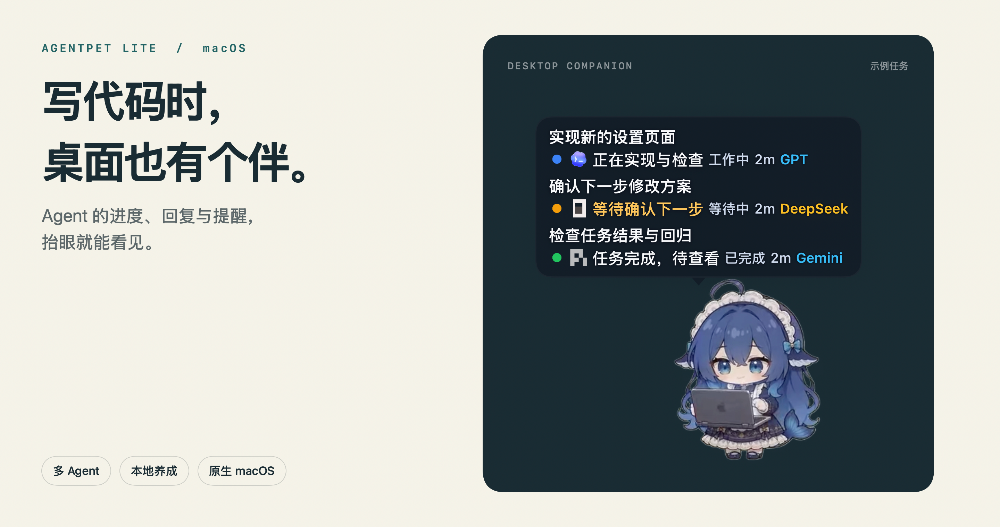
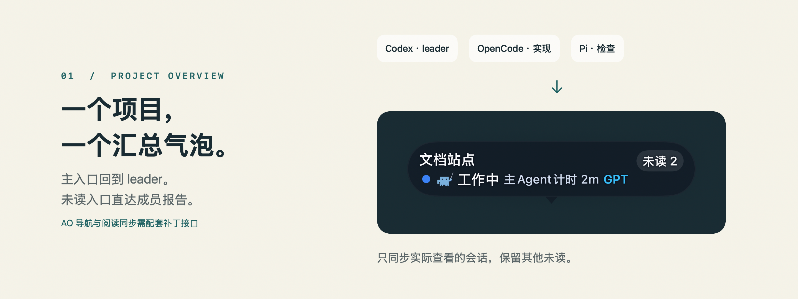
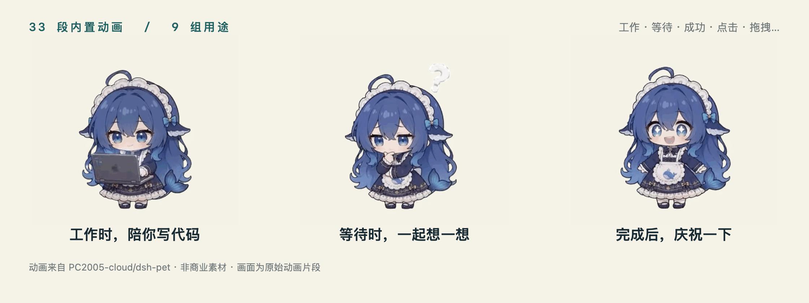
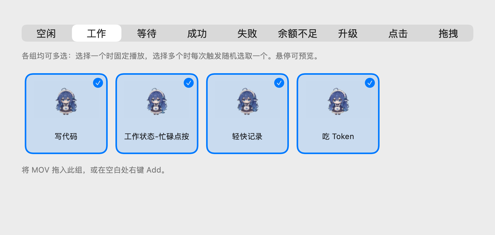
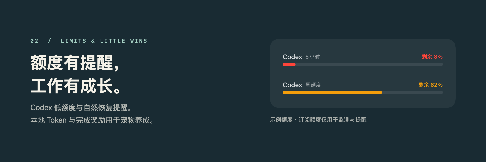
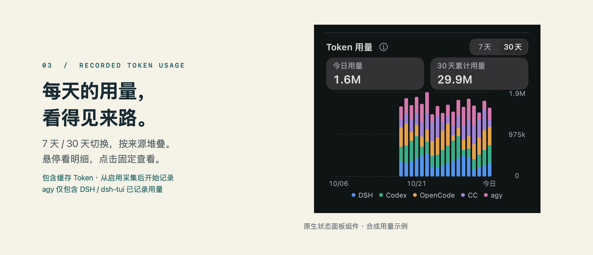

# AgentPet Lite

**简体中文** · [English](README.en.md)

**让 Agent 的进度，出现在桌面上。**

一个原生 macOS 桌宠，把编程 Agent 的任务状态、公开回复和待办提醒带到屏幕一角。你继续写代码，它陪你盯进度。

**macOS 13+ · Apple Silicon · Swift / SwiftUI · 本地养成**

[快速开始](#快速开始) · [支持的 Agent](#支持的-agent) · [接入指南](docs/agent-integrations.md) · [自定义动画](docs/pet-animation-packs.md)

[](.github/readme/hero.png)

基于 [AgentPet](https://github.com/ntd4996/agentpet) 持续维护的衍生版，重点完善多 Agent 接入、AO 项目汇总、已读同步、会话筛选和动画管理。默认鲸鱼娘动画来自 [dsh-pet](https://github.com/PC2005-cloud/dsh-pet)。

应用界面支持 **English / Tiếng Việt / 简体中文 / 繁體中文**，可在设置中切换。

> 图片中的任务、模型标签与额度均为演示数据；任务气泡和额度条使用当前源码中的原生组件渲染，动画取自内置素材。点击配图可查看原始分辨率。

## 抬眼就知道，该不该切回终端

| 你关心的事 | 桌面上的反馈 |
| --- | --- |
| 几个 Agent 同时在跑什么？ | 多会话任务气泡，显示任务、状态、模型和耗时；按来源筛选 |
| 它做完了，还是在等我？ | 区分工作、等待人工处理、完成、失败与停止，展示公开回复和提醒 |
| 该回哪一个会话？ | 点击已适配任务跳回对应会话，配合阅读回执管理未读 |
| 桌面会不会太吵？ | 支持气泡点击穿透、贴边收起、透明度与停留时间调节；过滤 Codex 内部辅助请求和临时侧边会话 |
| 除了看任务，还能做什么？ | 宠物养成、动画选择、项目绑定、自定义短句、额度提醒和番茄钟 |

公开回复来自 Agent 已产生的内容，**不额外调用模型生成闲聊**。双击宠物可切换任务气泡的点击穿透；遇到需要人工处理的事项，气泡会临时恢复可点击。

## 多 Agent 协作，一个项目一个气泡

使用 Agent Orchestrator（AO）时，同一项目的 leader 和 worker 汇总到一个入口。点主入口回 leader，点 **未读 N** 查看对应成员；只同步实际查看的会话，其他未读继续保留。

[](.github/readme/project-overview.png)

此功能为默认关闭的实验选项。精确导航与 AO 内已读同步需要提供对应接口的补丁版 AO；官方原版没有这些新增接口。[查看接入条件 →](docs/agent-integrations.md)

## 写代码，也养大一个桌面伙伴

首启离线提供 **33 段鲸鱼娘动画**。工作、等待、成功、失败、余额不足、升级、点击、拖拽和空闲，分成 **9 组用途**；同组可多选，让每次回应有些不同。

[](.github/readme/animations.gif)

本地 Codex / Claude Code 会话中可读取的 Token 用量，以及成功完成任务的奖励，用于积累经验。每只宠物分别保存等级、成长和成就；**订阅额度仅用于监测与提醒，不增加经验**。

<details>
<summary><strong>展开看看动画怎么选：多选、悬停预览与拖入导入</strong></summary>

[](.github/readme/animation-settings.png)

在设置 → 宠物 → 动画中调整。选一个可固定播放，选多个时每次触发随机选取；支持拖入符合格式的透明 MOV，也可以导入自己的动画包。[动画格式与导入指南 →](docs/pet-animation-packs.md)

</details>

## 额度有提醒，专注有节奏

Codex 低额度和自然恢复提醒，把“还剩多少、什么时候恢复”带到桌面；右键宠物打开状态面板，也能查看养成、额度和番茄计时。

[](.github/readme/quota.png)

## 按天查看已记录的 Token

状态面板支持 **7 天 / 30 天** 用量图，按来源分色堆叠；悬停查看当天明细，点击可固定查看。总量包含可读取的输入、输出及缓存 Token。

[](.github/readme/daily-usage.png)

采集按接入状态启停，从正式启用后开始记录，启用前日期显示“未开始统计”。其中 agy 分类仅包含 DSH / dsh-tui 已记录的用量，不含独立 agy CLI；来源不可读取或覆盖不完整时会保留相应提示。[计量范围与读取边界 →](docs/agent-integrations.md#recorded-daily-token-usage)

## 快速开始

当前面向 **macOS 13+ / Apple Silicon**。

### 1. 获取与安装应用

你可以安装预编译 DMG，或从源码自行构建：

- **方式一：安装预编译包（推荐）**<br>
  打开获得的 `AgentPet-Lite-1.0.0-arm64.dmg`，把 **AgentPet Lite.app** 拖入 **访达 → 应用程序（Applications）**，弹出磁盘映像后，从应用程序文件夹启动。下载入口为本项目 [Releases](https://github.com/jiziol/agentpet-lite/releases)；核对同版 `.dmg.sha256`，若尚无对应安装附件，可按下方说明从源码构建。
- **方式二：从源码构建**<br>
  需要完整 Xcode 与 Python 3.9+；已验证的工具链为 Xcode 26.3 / Swift 6.2.4，CI 使用同一版本。首次解析依赖需要联网。在项目根目录执行：

  ```sh
  swift package resolve --force-resolved-versions
  AGENTPET_APP_NAME="AgentPet Lite" bash scripts/build-local.sh
  ```

  产物为 `build/AgentPet Lite.app`，版本 `1.0.0`，Bundle ID 为 `io.github.jiziol.agentpet-lite`，数据目录为 `~/.agentpet-lite`。需要 DMG 时再执行 `python3 scripts/package-dmg.py`；脚本校验成功后保留 DMG 与 `.dmg.sha256`，移除重复的构建 `.app`，不修改已安装应用，也不自动安装、迁移或发布。

已有 AgentPet Local 数据的用户，请先按[迁移说明](docs/agent-integrations.md#从-local-迁移到-lite)操作，不要直接覆盖数据目录。

> [!NOTE]
> **macOS 首次打开的安全提示**<br>
> 当前应用与 DMG 使用 ad-hoc 签名，尚未使用 Developer ID 签名或进行 Apple 公证；首次打开从网络下载的副本时，macOS 可能提示“无法验证开发者”。<br>
> 核对来源后，先尝试打开应用，再前往 **系统设置 → 隐私与安全性 → 安全性**，找到 AgentPet Lite 点击 **仍要打开**，按系统提示通过 Touch ID 或密码确认，再点击 **打开**。详见 [Apple 官方说明](https://support.apple.com/zh-cn/102445)。

### 2. 在客户端中接入 AgentPet

打开应用后，前往 **设置 → 通用 → Agent 集成**：

- 确保已安装并配置对应的 Agent 客户端，点击对应的 **Install**。
- **Codex**：需在原生 `/hooks` 界面中审阅并信任 AgentPet 项；信任后先开始新一轮任务；未生效时，待任务结束后重开所用客户端，其他来源按接入说明重新加载。
- **DSH**：在其原生插件管理器中独立安装，应用内提供 **Test / Manage / ⓘ** 入口。

### 3. 开始使用（或先体验预览）

- **日常编码**：正常使用已接入的 Agent 客户端，桌宠气泡会显示该来源提供的任务进度与公开回复。
- **外观调试**：在 **设置 → 气泡** 中打开 **模拟任务与气泡预览**，可随时调整展示效果与穿透状态；预览数据仅在内存中模拟，不写入任何真实会话。

## 支持的 Agent

| Agent / 宿主 | 当前接入范围 |
| --- | --- |
| **Codex** | CLI 与桌面应用的已适配场景、Hook 接入、额度提醒 |
| **Antigravity CLI（agy）** | 终端与已适配宿主，沿用原生 `~/.gemini` 配置 |
| **OpenCode** | V1 / V2 独立插件，安装时检测版本；跨主版本升级需重新接入 |
| **DeepSeek Harness（DSH）** | 独立 [`@agentpet-lite/dsh-bridge`](https://github.com/jiziol/dsh-agentpet-bridge)，通过 DSH 原生插件管理器安装，按协议与能力连接 |
| **Pi Coding Agent** | 原生扩展、任务生命周期、接入安装与 Test |
| **Agent Orchestrator（AO）** | 本机项目聚合；精确导航、已读同步需配套补丁接口 |
| **Claude Code** | 保留部分兼容与设置入口，不承担后续适配维护 |

DSH TUI 提供独立的高级筛选开关，**默认隐藏、标记为“不适配”**，不提供桌面会话跳转。各客户端、版本与宿主的能力存在差异（历史停维范围与更多细节参见[维护政策](docs/maintenance-policy.md)），详细配置参见[接入指南](docs/agent-integrations.md)。

<details>
<summary><strong>构建、签名与更新说明</strong></summary>

- 当前脚本生成 `arm64` 包，执行 ad-hoc 签名及严格校验；未使用 Developer ID 签名或 Apple 公证，Intel 包尚未验证。尚无自动更新渠道；更新时需安装新版本 DMG 或自行构建。
- 构建正式 Lite 包：`AGENTPET_APP_NAME="AgentPet Lite" bash scripts/build-local.sh`。Lite 使用 `io.github.jiziol.agentpet-lite` 与 `~/.agentpet-lite`。若此前使用过内部预览版（AgentPet Local），迁移后由实例锁防止两个 GUI 并行写入；应用移动或改名后需要更新 Hook 注册。
- 可用 `DEVELOPER_DIR` 选择 Xcode，`AGENTPET_BUILD_CACHE` 指定缓存。依赖固定在 `Package.resolved`；构建禁用自动重新解析。固定源码、依赖与工具链可重新构建，不承诺签名包逐字节一致。
- 构建可复用缓存；脚本会映射本机调试路径并清除链接调试记录，分发前仍需核对二进制、资源与签名。应用构建不需要 npm 或 DSH 插件源码，不会替你安装桥接插件。
- 完整验证：`bash scripts/verify-local.sh full`。更多构建与开发说明见 [CONTRIBUTING.md](CONTRIBUTING.md)。

</details>

<details>
<summary><strong>本地数据、联网与卸载</strong></summary>

任务、阅读回执、养成、动画选择及额度去重状态保存在本机。正式 Lite 的运行目录为 `~/.agentpet-lite`，偏好域为 `io.github.jiziol.agentpet-lite`；若有旧预览版数据，可参考[迁移说明](docs/agent-integrations.md#从-local-迁移到-lite)保留，不要直接覆盖数据目录。默认宠物首启离线安装，不覆盖已有宠物选择和文件。

额度查询可能使用本机已有登录信息访问提供商；手动图库下载会发送安装统计。详见[隐私与安全](docs/maintenance-policy.md#隐私与安全)。本分支已移除旧网页主页、云端同步与历史页，保留已有本地归档数据。

卸载前先在 Agent 集成中 **Remove** 本项目接入，重开相关客户端，再退出并删除应用。DSH bridge 在 DSH 原生插件管理器中移除。Remove 保留其他插件、Agent 客户端及用户数据；数据清理请先备份并核对路径。[完整接入与移除说明 →](docs/agent-integrations.md)

</details>

## 文档与参与

[参与维护](CONTRIBUTING.md) · [架构导航](docs/architecture.md) · [能力与验证边界](docs/feature-comparison.md) · [动画包格式](docs/pet-animation-packs.md) · [公开范围](docs/public-scope.md)

反馈问题时，请提供应用 / macOS / Agent 版本、宿主组合与复现步骤；截图和日志先移除对话、账号、令牌及个人路径。

## 许可与致谢

源码沿用 **MIT**，保留 [AgentPet](https://github.com/ntd4996/agentpet) 作者 Nguyễn Thành Đạt（[@ntd4996](https://github.com/ntd4996)）的版权与来源署名。

默认鲸鱼娘主要来自 **[PC2005-cloud/dsh-pet](https://github.com/PC2005-cloud/dsh-pet)**，美术素材按**非商业用途**使用；介绍、展示与分发衍生作品时保留该项目链接。源码 MIT 不覆盖美术素材。完整来源与条款见[素材许可](Sources/App/Resources/DefaultPets/deepseek/LICENSE-ASSETS.md)、[第三方说明](THIRD_PARTY_NOTICES.md)和[配图来源](.github/readme/README.md)。
